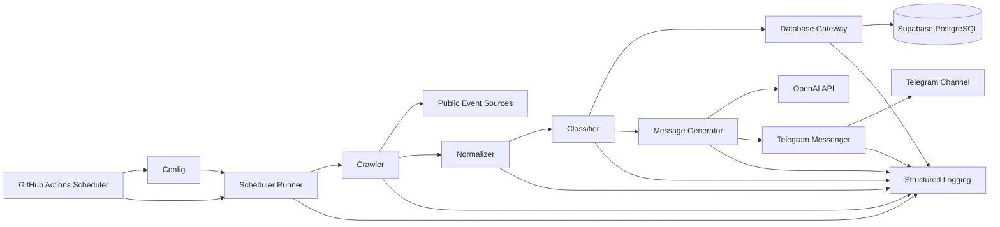

# Component Diagram

## 1. 컴포넌트 개요

아래 다이어그램은 MVP의 논리 컴포넌트와 외부 시스템 관계를 보여줍니다.

## 2. 컴포넌트 설명

- GitHub Actions Scheduler: 정기 실행과 수동 실행을 담당합니다.
- Config: 환경 변수와 비밀값을 검증합니다.
- Scheduler Runner: 전체 파이프라인 순서를 제어합니다.
- Crawler: 출처별 원문 이벤트 후보를 수집합니다.
- Normalizer: 원문을 공통 이벤트 모델로 변환합니다.
- Classifier: 이벤트 유형과 자전거 영향도를 분류합니다.
- Database Gateway: 저장, 조회, 중복 확인, 발행 이력 기록을 담당합니다.
- Message Generator: 발행 대상 이벤트를 짧은 안내 메시지로 생성합니다.
- Telegram Messenger: Telegram Channel에 메시지를 발행합니다.
- Structured Logging: 단계별 처리 결과와 오류를 기록합니다.

## 3. 외부 시스템

- Public Event Sources: 지자체, 행사, 공원, 도로 통제 관련 공공 페이지
- Supabase PostgreSQL: 이벤트와 실행 결과 저장소
- OpenAI API: 추론이 필요한 요약과 영향도 설명
- Telegram Bot API: Channel 메시지 발행

## 4. 사용자 입력 필요 항목

- `[사용자 입력 필요]` 첫 번째로 연결할 Public Event Source
- `[사용자 입력 필요]` Telegram Channel 테스트 환경 사용 여부
- `[사용자 입력 필요]` Supabase 프로젝트 생성 완료 여부
