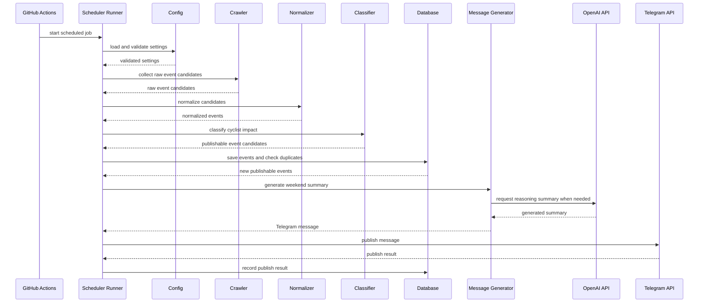
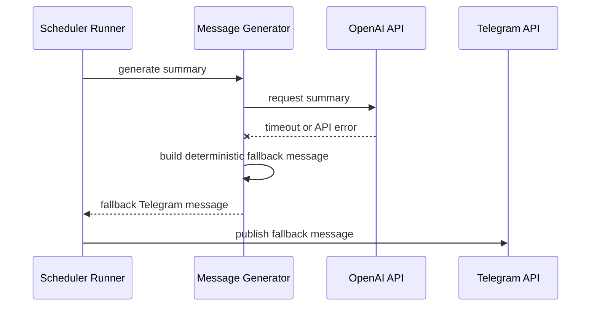
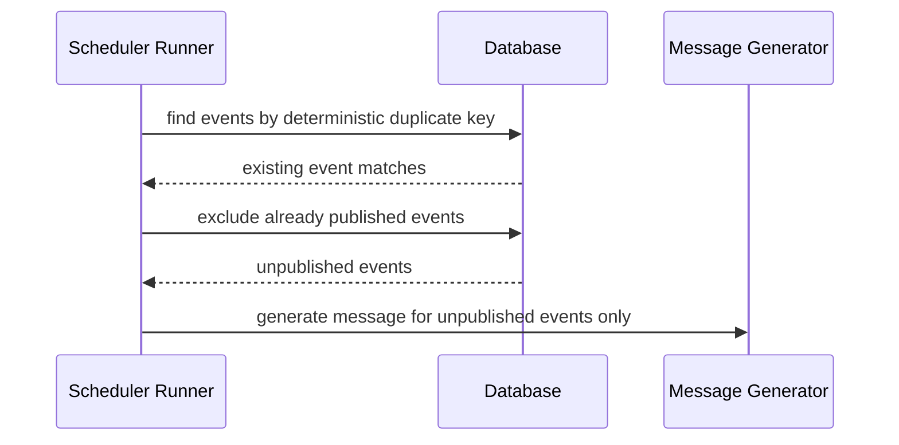

# Sequence Diagram

## 1. 정기 실행 시퀀스

## 2. Fallback 시퀀스

AI 요약이 실패하면 Generator는 정규화된 이벤트 필드만 사용해 fallback 메시지를 생성합니다.

## 3. 중복 방지 시퀀스

## 4. 사용자 입력 필요 항목

- `[사용자 입력 필요]` AI 실패 시 fallback 메시지를 발행할지, 발행을 중단할지 여부
- `[사용자 입력 필요]` 중복으로 의심되지만 확실하지 않은 이벤트의 기본 처리 방식
