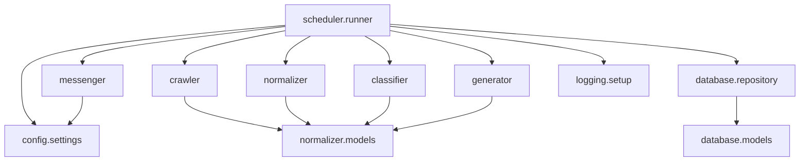

# Dependency Graph

## 1. 의존성 방향

의존성은 실행 진입점에서 하위 기능 모듈로 흐릅니다. 기능 모듈끼리 순환 의존하지 않습니다.

## 2. 허용되는 의존성

- `scheduler`는 모든 주요 모듈을 호출할 수 있습니다.
- `config`는 다른 애플리케이션 모듈에 의존하지 않습니다.
- `crawler`는 HTTP 클라이언트와 파서에 의존할 수 있습니다.
- `normalizer`는 Pydantic 모델에 의존할 수 있습니다.
- `classifier`는 정규화 모델을 입력으로 받습니다.
- `database`는 SQLAlchemy와 Alembic에 의존합니다.
- `generator`는 OpenAI 클라이언트와 fallback 생성기를 사용할 수 있습니다.
- `messenger`는 Telegram Bot API 클라이언트에 의존합니다.
- `logging`은 표준 logging 구성을 제공합니다.

## 3. 금지되는 의존성

- `crawler`가 Telegram 발행 모듈을 직접 호출하지 않습니다.
- `normalizer`가 데이터베이스 저장을 직접 수행하지 않습니다.
- `generator`가 크롤러를 직접 실행하지 않습니다.
- `messenger`가 데이터베이스에 직접 접근하지 않습니다.
- 하위 모듈이 `scheduler.runner`에 의존하지 않습니다.

## 4. 사용자 입력 필요 항목

- `[사용자 입력 필요]` OpenAI 클라이언트 래퍼를 프로젝트 내부에 둘지, 공식 SDK를 직접 호출할지 여부
- `[사용자 입력 필요]` Telegram 클라이언트 라이브러리 사용 여부 또는 Requests 직접 호출 여부
