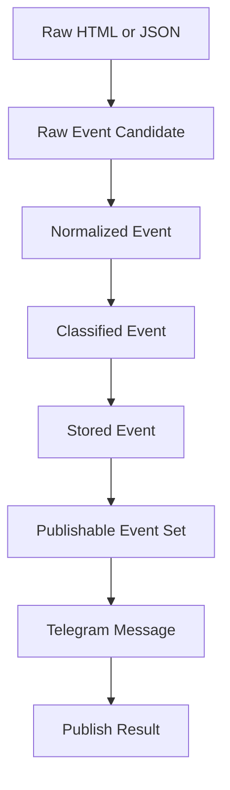

# Data Flow

## 1. 데이터 흐름 개요

## 2. Raw Event Candidate

원문 출처에서 수집된 초기 데이터입니다.

예상 필드:

- source_name
- source_url
- fetched_at
- raw_title
- raw_body
- raw_date_text
- raw_location_text

## 3. Normalized Event

발행과 저장에 사용할 표준 이벤트입니다.

예상 필드:

- title
- start_datetime
- end_datetime
- location_name
- region
- source_url
- source_name
- raw_summary
- deterministic_duplicate_key

## 4. Classified Event

자전거 이용자 영향 판단이 추가된 이벤트입니다.

예상 필드:

- event_type
- cyclist_impact_level
- cyclist_impact_reason
- publish_candidate

## 5. Stored Event

데이터베이스에 저장된 이벤트입니다.

예상 필드:

- event_id
- raw_event_id
- normalized fields
- classification fields
- created_at
- updated_at

## 6. Publishable Event Set

발행 대상 이벤트 묶음입니다.

포함 조건:

- 주말 또는 설정된 알림 기간에 영향을 줍니다.
- 필수 필드가 존재합니다.
- 중복 발행되지 않았습니다.
- 자전거 이용자에게 의미 있는 영향이 있습니다.

## 7. Telegram Message

최종 사용자에게 발행되는 메시지입니다.

포함 정보:

- 핵심 주의 구간
- 영향 날짜 또는 시간대
- 이벤트 이유
- 원문 링크
- 불확실성 표시

## 8. 사용자 입력 필요 항목

- `[사용자 입력 필요]` cyclist_impact_level 등급 이름
- `[사용자 입력 필요]` 빈 주말에도 "특이사항 없음" 메시지를 보낼지 여부
- `[사용자 입력 필요]` 메시지에 포함할 최대 이벤트 수
