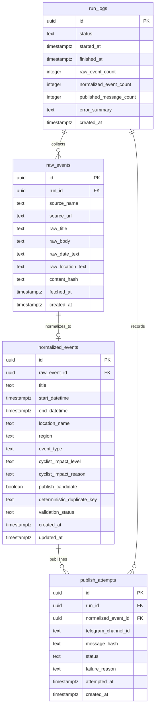

# Database ERD

## 1. ERD 개요

MVP 데이터베이스는 원문 수집 결과, 정규화된 이벤트, 실행 기록, 발행 이력을 분리합니다.

## 2. 테이블 선택 이유

- `run_logs`: GitHub Actions 실행 단위의 성공, 실패, 처리 건수를 추적합니다.
- `raw_events`: 크롤러가 가져온 원문 후보를 보존합니다.
- `normalized_events`: 발행 판단에 필요한 표준 이벤트 데이터를 저장합니다.
- `publish_attempts`: Telegram 발행 결과와 중복 발행 방지를 추적합니다.

## 3. MVP에서 제외하는 테이블

- 사용자 계정 테이블
- 개인화 경로 테이블
- 결제 테이블
- 웹 관리자 테이블
- 상세 분석 테이블

## 4. 사용자 입력 필요 항목

- `[사용자 입력 필요]` Supabase PostgreSQL에서 UUID 생성 확장 사용 가능 여부
- `[사용자 입력 필요]` Telegram Channel ID를 평문으로 저장해도 되는지 여부
- `[사용자 입력 필요]` 실행 로그를 데이터베이스에 저장하는 방식 승인 여부
