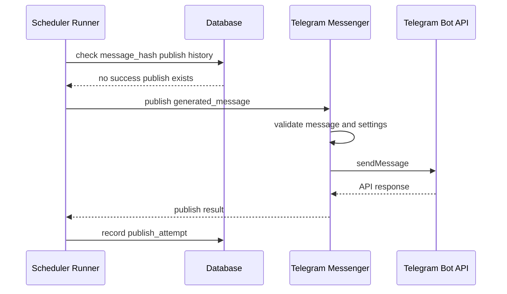
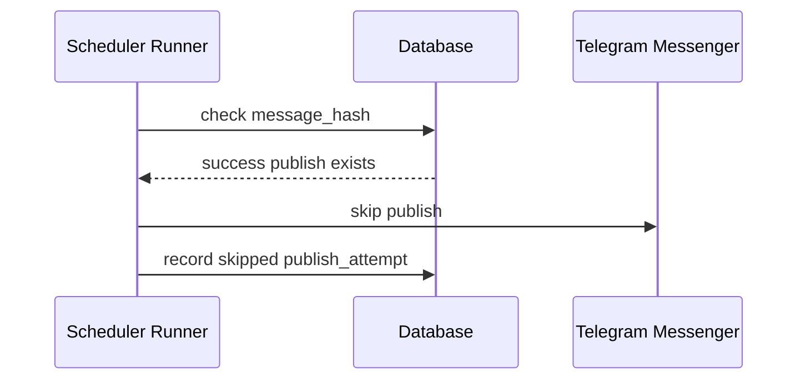

# Bot Flow

## 1. 발행 흐름

## 2. 중복 발행 방지 흐름

## 3. Bot 권한 흐름

운영 전 확인:

1. Bot을 Channel 관리자로 추가합니다.
2. 메시지 게시 권한을 부여합니다.
3. 테스트 메시지를 수동으로 발행합니다.
4. 성공한 Channel ID를 Secrets에 저장합니다.

## 4. API 호출 방식

MVP에서는 polling이나 webhook을 사용하지 않습니다.

사용 API:

- `sendMessage`

권장 옵션:

- parse mode는 초기 MVP에서 사용하지 않습니다.
- Markdown/HTML formatting은 메시지 깨짐 위험이 있으므로 보류합니다.
- 링크는 일반 텍스트 URL로 포함합니다.

## 5. 사용자 입력 필요 항목

- `[사용자 입력 필요]` Bot을 Channel 관리자로 추가할 운영자
- `[사용자 입력 필요]` 테스트 메시지를 실제 채널에 보낼지 테스트 채널에 보낼지 여부
- `[사용자 입력 필요]` Telegram parse mode 사용 여부
